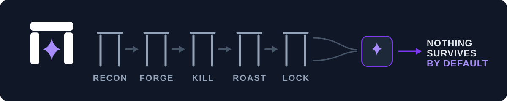

<p align="center">
  <a href="#-the-kill-chain"></a>
</p>

<h1 align="center">Idiotation</h1>

<p align="center"><strong>The ideation kill-chain.</strong> An AI agent pack that finds the best ideas for <em>your</em> gate — and kills every idea that can't prove it belongs there.</p>

<p align="center">
  <a href="LICENSE"></a>
  
  
  
</p>

---

## Why

Every ideation tool generates more ideas. Idiotation generates **fewer, stronger** ones — by forcing each candidate to survive evidence, structured disagreement, and adversarial judgment **before a single line of product code is written**.

The core asset, and the constitution every gate judges against:

> **A good idea is a bet with real structure, shaped to the specific gate it has to pass, that gets stronger every time it passes.**

- **Structure — it can be wrong.** If nothing can falsify it, it isn't an idea; it's a mood.
- **Fit — it is shaped to a gate.** Nothing works in the abstract; it works *for* a gate.
- **Surface — the structure shows.** Glance-readable, with depth when you lean in.
- **Loop — it compounds.** What gets better the second time?

Fail one part → *nice*. Fail two → *bad*. Fail three → *mood*. Full theory: [`PHILOSOPHY.md`](PHILOSOPHY.md).

## The kill-chain

Nothing survives by default. Each gate exists to kill or refine; each gate inherits the last one's output.

```mermaid
flowchart LR
    A["GATE 0 · RECON<br/>/gate-recon<br/>Firecrawl evidence +<br/>5 lenses + Terrain Gate"] -->|"GATE_PROFILE.md<br/>TERRAIN_MAP.md"| B["GATE 1 · FORGE<br/>/idea-forge<br/>brainstorm + council,<br/>lens-ranked"]
    B -->|"IDEA_SHORTLIST.md<br/>top 3"| C["GATE 2 · KILL<br/>/idea-kill<br/>falsify + real 30-min spikes"]
    C -->|"KILL_REPORT.md<br/>one survivor"| D["GATE 3 · ROAST<br/>/idea-roast<br/>7 hostile judges, 3 rounds"]
    D -->|"ROAST_REPORT.md<br/>GO / RESHAPE / KILL"| E["GATE 4 · LOCK<br/>/idea-lock<br/>promise + rubric map"]
    E -->|"IDEA_LOCK.md"| F["SPEC WORKFLOW<br/>grill-with-docs → to-spec<br/>to-tickets → tdd →<br/>implement → code-review"]
```



The `good-idea` skill is not a stage — it is the **lens applied at every gate**, so the pipeline judges against your definition of good, not the models' taste.

## The skills

| Skill | Gate | One job | Output |
|---|---|---|---|
| `/gate-recon` | 0 | Acquire the gate's evidence (Firecrawl), run the five lenses + hostile Terrain Gate | `GATE_PROFILE.md`, `TERRAIN_MAP.md` |
| `/idea-forge` | 1 | Brainstorm what you actually want; council of models generates + blind-reviews 10 theses | `IDEA_SHORTLIST.md` |
| `/idea-kill` | 2 | Falsify the top 3; run a **real** 30-minute spike against the riskiest assumption | `KILL_REPORT.md` — one survivor |
| `/idea-roast` | 3 | 7-judge hostile panel finds the three fastest ways you lose in the first 60 seconds | `ROAST_REPORT.md` — GO / RESHAPE / KILL |
| `/idea-lock` | 4 | One-line promise + rubric→artifact map; hand off to the spec workflow | `IDEA_LOCK.md` |
| `/good-idea` | lens | The four-part test + verdict scale, applied at every gate | verdict + smallest change to pass |

## Quick start

```bash
# 1. use this repo as your working folder (skills live in .opencode/skills + .claude/skills)
cd Idiotation

# 2. optionally clone the five engine blocks (all skills work without them)
powershell -ExecutionPolicy Bypass -File scripts\install-blocks.ps1     # or: bash scripts/install-blocks.sh

# 3. optionally install your everyday skills globally (brand, logo, readme, matt pocock engineering)
powershell -ExecutionPolicy Bypass -File scripts\install-global-skills.ps1 -ZipsDir "$HOME\Downloads"
```

Then, in a session, run the gates in sequence:

```text
/gate-recon <your gate>      # T-7..T-5 · map the mechanism first
/idea-forge                  # T-5     · 10 theses, lens-ranked
/idea-kill                   # T-4     · spikes or it didn't happen
/idea-roast                  # T-3     · the hostile panel
/idea-lock                   # T-3     · the contract
/grill-with-docs → /to-spec → /to-tickets → /tdd → /implement → /code-review
```

**One-shot variant (same-day event):** 15 min recon (one lens) → 30 min forge (5 theses → top 1) → 20 min kill (one real spike) → 20 min roast (4 judges) → 10 min lock. Same chain, compressed.

## The five engine blocks

Idiotation orchestrates five best-in-class tools, each doing the one job it does best — in sequence, never as a crowd:

| Block | Owner of | License | Usage |
|---|---|---|---|
| [Firecrawl](https://github.com/firecrawl/firecrawl) | Gate 0 evidence | AGPL-3.0 | external API/MCP only — **never vendored** |
| [Maxxing V2 Gauntlet](https://github.com/Tulip9ZZZA/maxxing-itout) (branch `v2-gauntlet`) | 5 lenses + Terrain Gate | MIT | cloned under `blocks/`; protocol also runs natively |
| [Superpowers](https://github.com/obra/superpowers) | brainstorming + planning discipline | MIT | cloned under `blocks/`; discipline embedded in skills |
| Council protocol (idea from [karpathy/llm-council](https://github.com/karpathy/llm-council)) | multi-model blind review | **no license** | the *idea* only — our implementation is original, nothing copied |
| [Roast Room](https://github.com/nateherkai/roast-room) | hostile council mechanics | MIT | adapted with generic judge roles; clone for the expert-brain version |

Full compliance notes: [`CREDITS.md`](CREDITS.md).

## Repository map

```text
Idiotation/
├── AGENTS.md                  # the 5-agent pipeline contract (auto-loaded by agents)
├── PHILOSOPHY.md              # the good-idea constitution
├── .opencode/skills/          # the 6 skills (canonical)
├── .claude/skills/            # mirror for Claude Code (scripts/sync-skills.ps1)
├── docs/
│   ├── ARCHITECTURE.md        # why sequential pressure beats the crowd
│   ├── USAGE.md               # run sequence + one-shot variant + checklists
│   └── templates/             # the 6 output-document templates
├── scripts/                   # install-blocks · install-global-skills · sync-skills
├── assets/                    # logo mark, tile, favicon, banner (pure SVG)
└── sessions/                  # your runs: evidence + reports archive here
```

## License

MIT — see [`LICENSE`](LICENSE). The five blocks remain under their own licenses (see [`CREDITS.md`](CREDITS.md)); using Idiotation does not redistribute any of them.

<p align="center"><sub>Built with the <a href="https://github.com/mattpocock/skills">Matt Pocock real-engineer skills</a>, the <a href="https://github.com/oil-oil/beautify-github-readme">beautify-readme skill</a>, the <a href="https://github.com/kaankiziltug/logo-design-skill">logo-design skill</a> and the <a href="https://github.com/cofoundy/brand-skills">brand-skills</a> suite — all MIT.</sub></p>
